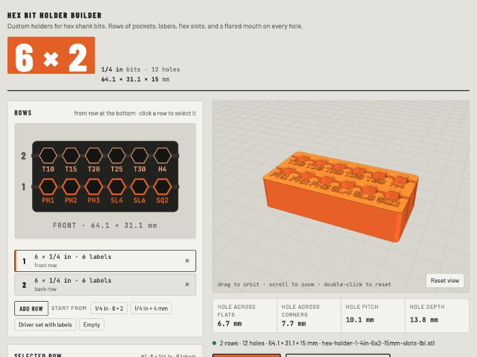

# Hex Bit Holder Builder

Print custom holders for hex shank bits. Lay out rows of pockets for 1/4 in, 5/16 in, 4, 5, or 6 mm shanks (or any size you type in), label each hole, preview the holder in 3D, and download the STL.

[](https://philhoyt.github.io/Hex-Bit-Holder-Generator/)

[](https://philhoyt.github.io/Hex-Bit-Holder-Generator/)

It grew out of the [Storehouse Bin Builder](https://github.com/philhoyt/Storehouse-Bin-Generator) and shares its approach: a plain web page, its own mesh code, golden tests on the exported bytes, and an OpenSCAD twin. The holder itself follows the classic [Customizable Hex Bit Holder](https://www.thingiverse.com/thing:726700) on Thingiverse (rows of hex pockets, optional flex slots), rebuilt from scratch with labels and a flared mouth on every hole.

## Use it

**[Open the Hex Bit Holder Builder](https://philhoyt.github.io/Hex-Bit-Holder-Generator/)**

It runs in your browser. No install, no account. To run it from a local checkout, serve the folder (for example `npm run serve`, then open http://localhost:8766). Opening `index.html` straight from disk won't work, because the app is split into modules that browsers only load over HTTP.

1. Add rows. Each row has its own bit size and number of holes, so one holder can take 1/4 in drivers in front and 4 mm bits behind.
2. Type a label for any hole: `PH2`, `T25`, `5/32`. Letters are raised on the top face in front of the hole.
3. Set the height, closed or through holes, the flared mouth, flex slots, and the corner radius.
4. Click **Download STL**. Print it flat, no supports.

## The holder

- **Pockets** are hexagons with the points running along the row, sized to the bit plus a clearance on every side. Default clearance is 0.15 mm, which grips a 1/4 in shank on most printers.
- **Flared mouth.** Each hole opens out by 0.5 mm at the top, so bits find the pocket without aiming. It is limited to what the walls allow.
- **Closed or through.** Closed holes keep a 1.2 mm floor so bits stay put when you pick the holder up. Through holes let you push a stuck bit out from below.
- **Flex slots** cut along each row, through the holes and out both sides, to 75% of the height. The pockets then flex a little and grip harder, the way the original Thingiverse design does.
- **Labels.** Up to 8 characters per hole: letters, numbers, space, and `- . / +`. Lowercase prints as capitals. Letters are 3 mm tall and shrink to 2 mm to fit between neighbors, then lose characters off the end. The panel says what fits. A row with labels gets a band in front of it for the letters.
- **Layout.** Holes are 2.4 mm apart (web between the corners), 3 mm from the edges. Rows are centered, and the widest row sets the width.

## Fit

If a test print is loose or tight, open **Fit and print > Download fit test**. It is a short strip with four holes at 0.10, 0.15, 0.20, and 0.25 mm clearance per side, each labeled. Push a bit into each and enter the clearance that grips under **Hole clearance per side**.

## Development

```bash
npm install
npm run check
```

`npm run check` lints with ESLint and runs the tests; `npm run lint` and `npm test` do each on its own. ESLint is the only dependency. The tests run on Node's built-in runner.

Two kinds of test guard the mesh. Every holder the tests build is checked to be watertight: each edge must be shared by exactly two triangles running opposite ways. And the enclosed volume of each one is compared with what the dimensions say it should be (the slab, less the hex prisms, less the slots and the flare). The golden tests hash the exported STL for a set of holders and compare them with values recorded from the real page in Chrome, so any change to the geometry or the export format shows up as a failure; re-record them only when the change is intended. The mesh code uses its own trig series instead of `Math.sin` and friends so that every JavaScript engine produces the same bytes.

GitHub Actions runs the same check on every push and pull request, and publishes the site to GitHub Pages only when it passes on `main`.

## How the mesh is built

There is no CSG library. The body is one closed shell built from 2D regions: the outline is cut into horizontal bands at each row, hex-shaped notches are carved into the band edges, and each band is ear-clipped into triangles. Walls are strips between the same 2D points at two heights, so every vertex is shared exactly. Slots add a second level (the slot floor) with its own faces and walls, and the flared mouth is a sloped ring between the hole at the top and a hex offset outward. Letters are small boxes that overlap the top face, like the labels in the bin builder.

## OpenSCAD

`hex_bit_holder.scad` builds the same holders in OpenSCAD with the Customizer, labels included (OpenSCAD uses a real font, the app uses a stroke font). In the web app, **Copy OpenSCAD settings** gives you a block to paste over the settings at the top of the file.

## Files

| File | What it is |
|---|---|
| `index.html` | The page: markup and styles. Loads three.js from a CDN and the app from `src/`. |
| `src/app.js` | Everything that touches the page: the plan view, the panel, the 3D view, downloads. |
| `src/geometry.js` | The layout and the mesh: bands, notches, ear clipping, walls, slots, flares, letters. |
| `src/export.js` | File names, the STL and zip writers, the OpenSCAD settings block, the fit test. |
| `src/state.js` | Bit sizes, defaults, limits, and the checked restore of saved state. |
| `src/font.js` | The stroke font and label helpers. |
| `test/` | Node tests: watertight and volume checks, golden checksums, unit tests. |
| `hex_bit_holder.scad` | OpenSCAD version of the generator. |
